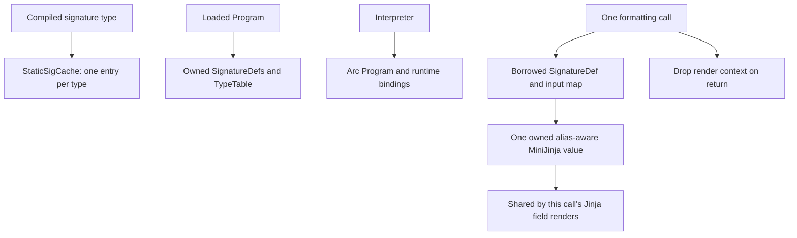

# Input rendering ownership and performance

`ChatAdapter::format_input_def` builds an alias-aware MiniJinja input value
lazily, once per call. Every Jinja field shares that immutable value. Default
and format-only inputs never build it. The value is dropped when formatting
returns, so subsequent calls see their current input. There is no global cache
of dynamic signatures, input values or owned templates.

Previously, each Jinja field cloned the complete input map, added aliases, then
serialized it through a JSON outer context into MiniJinja again. Wide signatures
therefore repeated work proportional to the entire input for each Jinja field.
The new outer context carries the existing MiniJinja value directly. Field
metadata, strict undefined handling, template compilation and prompt delimiters
retain their existing behavior.

## Ownership boundaries



The static cache is bounded by compiled signature types. Dynamically loaded
program definitions are owned by their program and are not leaked into that
cache. Immutable graph state can be shared; per-run execution state and this
render context remain local. See `ir/sig.rs`, `ir/program.rs` and the runtime
guide for the existing architecture. This change addresses one measured clone
hotspot; it is not a claim that every clone in the repository is unnecessary or
that issue #25's broader ownership redesign is complete.

## Controlled comparison

Build the identical `bench-input-rendering` harness at a clean baseline and a
clean candidate revision, with the same lockfile, toolchain and release flags:

```text
cargo build -p dspy-rs --release --no-default-features --locked --example bench-input-rendering -j1
python benchmarks/rendering/run.py --baseline ../baseline.exe --baseline-revision BASE_SHA --candidate target/release/examples/bench-input-rendering.exe --out ../render-evidence
```

Retain each binary immediately after its build so the second build cannot
overwrite the first. Record build commands, CPU and power policy with the
generated manifest. The runner checks identical committed harness source and
hashes both binaries; the caller is responsible for building those binaries
from the stated clean revisions. On Unix omit `.exe`.

The fixed workload renders one 32 KiB plain payload plus 1, 8 or 16 string
fields, either plain or Jinja-rendered. Aliases, field metadata and the shared
payload are accessed in every Jinja template. Each case warms up 100 times,
then runs 2,000 iterations per timing sample. Eight samples per binary alternate
ABBA order. The 200-iteration allocation profile runs separately; its timings
are not used for latency comparisons. Allocation counts include successful
allocations and reallocations, and byte counts sum requested sizes, not peak
live memory or RSS. The forwarding allocator's disabled counter branch exists
in both timing binaries.

Before timing, all six complete rendered outputs must match byte for byte;
their SHA-256 hashes are retained. Functional tests also cover aliases,
explicit alias collisions, changed inputs across calls, metadata, missing
fields and non-Jinja formatting.

The predeclared acceptance checks use medians of run means: default-rendering
latency ratio at most 1.10; Jinja latency ratio at most 0.90; and allocated-byte
ratio at most 0.50 for widths 8 and 16. Retain every raw sample and report any
failed control rather than changing the workload after observing results.
These are descriptive local criteria, not statistical confidence bounds.

This measures prompt rendering only. It does not establish a twofold improvement
in inference or I/O (#22), measure a live provider, or implement automatic graph
fusion/splitting (#26/#28).
